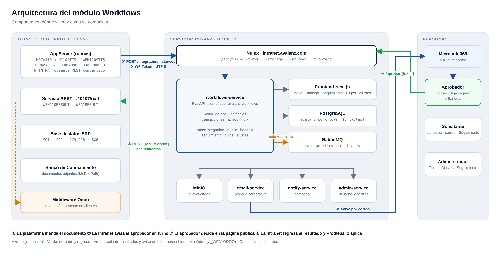

# Workflows · Intranet Avalanz

Módulo de aprobaciones de la Intranet Avalanz. Sustituye a Fluig (TOTVS) para los flujos de aprobación del ERP: la plataforma (Protheus) manda el documento, la Intranet lo hace recorrer su cascada de aprobadores y regresa la decisión para que la plataforma la aplique.

Estado: en desarrollo (rama `feature/workflows-service`). Flujos en operación en el ambiente de desarrollo: **Solicitud de compra directa** (`CompraDirecta`) y **Alta de cliente** (`AltaCliente`).

## Arquitectura

## Documentación

**Contexto**

| Documento | Para quién |
|---|---|
| [contexto-general.md](contexto-general.md) | Todos: qué es el módulo, por qué existe, cómo funciona de punta a punta y qué decisiones lo gobiernan |
| [contexto-workflows.md](contexto-workflows.md) | Documento de diseño original (histórico), con el prototipo y las capturas de arranque |

**Técnica** (TI y desarrollo)

| Documento | Contenido |
|---|---|
| [tecnico/01-arquitectura.md](tecnico/01-arquitectura.md) | Servicio, base de datos (18 tablas), estructura del código y API |
| [tecnico/02-motor.md](tecnico/02-motor.md) | Ciclo de vida del trámite, grupos y etapas, decisiones, ligas, bandeja de salida y avisos |
| [tecnico/03-integracion-plataformas.md](tecnico/03-integracion-plataformas.md) | Contrato de integración y fuentes de Protheus por flujo |
| [tecnico/04-hoja-y-plantillas.md](tecnico/04-hoja-y-plantillas.md) | Hoja del trámite: configuración, armado, página de aprobación, correos, estilos e impresión |
| [tecnico/05-ajustes-y-seguridad.md](tecnico/05-ajustes-y-seguridad.md) | Ajustes del módulo, tokens, cifrado, permisos y bitácora |
| [tecnico/06-entorno-de-desarrollo.md](tecnico/06-entorno-de-desarrollo.md) | Entorno de desarrollo, despliegue, pruebas y solución de problemas |

**Manuales** (usuarios del módulo)

| Manual | Quién lo usa |
|---|---|
| [manuales/01-conexiones.md](manuales/01-conexiones.md) | TI: dar de alta y probar la conexión con una plataforma |
| [manuales/02-usuarios-de-plataformas.md](manuales/02-usuarios-de-plataformas.md) | TI: ligar usuarios de Protheus con usuarios de la Intranet |
| [manuales/03-flujos.md](manuales/03-flujos.md) | Administrador / diseñador: crear flujos, grupos, etapas y aprobadores |
| [manuales/04-hoja-del-tramite.md](manuales/04-hoja-del-tramite.md) | Administrador / diseñador: cómo se ve el documento para el aprobador |
| [manuales/05-bandeja-y-aprobacion.md](manuales/05-bandeja-y-aprobacion.md) | Aprobadores y solicitantes |
| [manuales/06-seguimiento.md](manuales/06-seguimiento.md) | Administrador / auditoría: trámites, transacciones y acciones |
| [manuales/07-ajustes.md](manuales/07-ajustes.md) | TI: correos, folios, estilo y ligas |
| [manuales/08-protheus-usuarios.md](manuales/08-protheus-usuarios.md) | Capturistas en Protheus: solicitud de compra y alta de cliente |

**Diagramas** (`img/arquitectura/`)

| Imagen | Muestra |
|---|---|
| `01-arquitectura.png` | Componentes del módulo y cómo se comunican |
| `02-recorrido.png` | Recorrido de un trámite paso a paso |
| `03-estados.png` | Estados del trámite, de sus etapas y de la afectación |
| `04-grupos-y-etapas.png` | Cómo se elige el grupo y qué etapas aplican |
| `05-bandeja-de-salida.png` | Regreso del resultado y reintentos |
| `06-modelo-de-datos.png` | Las 18 tablas y sus relaciones |
| `07-hoja-del-tramite.png` | De la configuración de la hoja a la pantalla y al correo |
| `08-alta-de-cliente-odoo.png` | Alta de cliente con la integración de Odoo |
