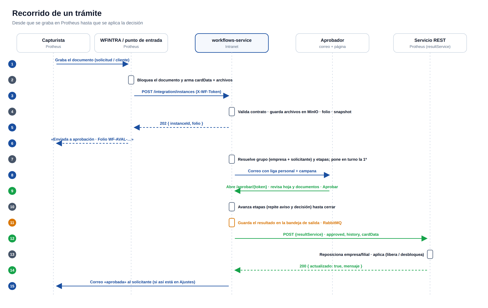
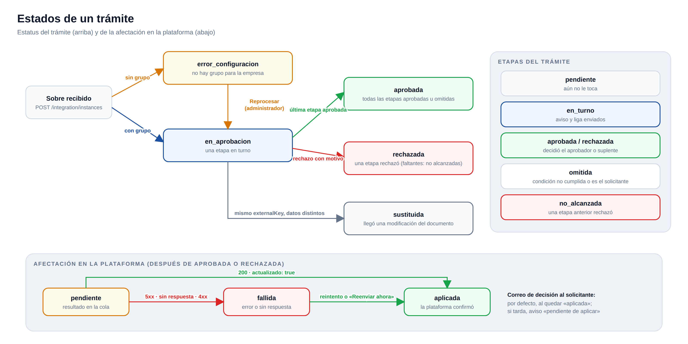
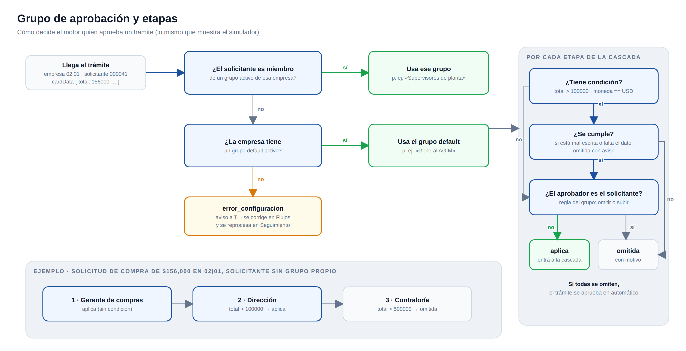
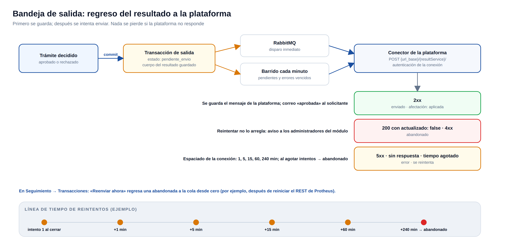

# 02 · Motor

El motor vive en `app/motor/` y no depende de las rutas: las mismas funciones las usan la integración, la Bandeja, la página pública, Seguimiento y el simulador. Regla general: **primero se guarda y se hace commit; los avisos y el envío a la plataforma son "mejor esfuerzo" después**. Un correo que falla nunca deja un trámite a medias.

## 1. Recepción del sobre (`instancias.recibir`)

1. **Autenticación** (`routes/integration`): el `X-WF-Token` se compara contra el token de entrada de cada conexión (cifrado); si la conexión está inactiva, `409`.
2. **Contrato**: el cuerpo se valida contra el modelo `Sobre` con `extra="forbid"`; un campo desconocido o faltante regresa `400` diciendo cuál.
3. **Flujo**: se busca por `processId` o sus aliases dentro de la conexión; si no existe, `404`; si está inactivo, `409`. Esto ocurre **antes** de subir archivos, para no dejar basura en MinIO.
4. **Archivos**: cada `files[]` (base64) se decodifica, se valida (máximo 25 MB por archivo) y se sube a MinIO con su SHA-256.
5. **Idempotencia y "Modificar"** por `externalKey`:
   - Si ya hay un trámite **abierto** con la misma clave y el mismo `cardData` (comparación por hash), se regresa ese mismo (`200`) y se anota "reenvío ignorado".
   - Si hay uno abierto con datos **distintos**, el anterior pasa a `sustituida` (sus etapas pendientes a `no_alcanzada`, sus ligas se invalidan) y nace uno nuevo.
   - Si el anterior ya estaba **cerrado**, nace uno nuevo.
6. **Folio**: `PREFIJO-FAMILIA-000001` (ajustes `folio.prefijo` y `folio.familia`), con `SELECT … FOR UPDATE` sobre `folio_counters` para que dos envíos simultáneos nunca repitan.
7. **Solicitante**: se busca la liga en `conexion_usuarios` por id de la plataforma; si no existe se crea, y si viene correo se intenta ligar automáticamente con el usuario de la Intranet que tenga ese correo.
8. **Snapshot**: el trámite guarda la versión vigente del flujo, el `cardData` completo y la transacción de entrada.
9. **Grupo y etapas** (abajo). Si no hay grupo para la empresa, el trámite nace en `error_configuracion` y se avisa a TI.
10. Contesta `202 { instanceId, folio, status, message }`. Luego, ya guardado: acuse al solicitante (si está activo), aviso al primer aprobador, o, si todas las etapas se omitieron, cierre y envío del resultado.

## 2. Grupo y etapas (`grupos.py`)

**Resolución del grupo** para la empresa del trámite (`origen_clave = companyGroup|tenantId[:2]`):

1. Si el solicitante es **miembro** de un grupo activo de esa empresa → ese grupo.
2. Si no, el grupo **default** de esa empresa.
3. Si no hay ninguno → `error_configuracion`.

**Armado de etapas** a partir de la cascada del grupo:

| Caso | Resultado |
|---|---|
| La etapa tiene condición (`total > 100000`) y no se cumple | `omitida`, con el motivo |
| La condición está mal escrita o el campo no viene en `cardData` | `omitida` con aviso (nunca se aprueba por un error de captura) |
| El solicitante es el aprobador de la etapa y el grupo dice "omitir" | `omitida` |
| El solicitante es el aprobador y el grupo dice "subir" | La decisión pasa a la siguiente etapa |
| Todas las etapas se omiten | El trámite se aprueba en automático |

Condiciones soportadas: `campo operador valor` con `> < >= <= == !=`; campos anidados con punto (`proveedor.tipo`); numéricos o texto (texto solo `==` y `!=`, sin distinguir mayúsculas).

El **simulador** de Flujos llama a estas mismas funciones con la definición vigente, así que lo que muestra es exactamente lo que hará el motor.

## 3. Avance y decisión

- `avanzar`: pone en turno la siguiente etapa pendiente, emite una **liga** para el aprobador y otra para el suplente, y regresa a quién avisar. Si no queda ninguna etapa, cierra como `aprobada`, marca `afectacion = pendiente` y **encola el resultado**.
- `decidir` (desde la Bandeja o la liga):
  - Solo decide el aprobador o el suplente de la etapa en turno (un administrador también, desde la Bandeja).
  - Rechazar exige comentario si la etapa lo pide (por defecto, sí).
  - Registra quién decidió, cuándo, el comentario, la vía (`bandeja` o `liga`), la IP y su **id en la plataforma** (de `conexion_usuarios`; si el usuario está ligado a varios, se prefiere el que tiene su mismo correo).
  - Aprobar → `avanzar`. Rechazar → el trámite pasa a `rechazada`, las etapas que faltaban a `no_alcanzada`, y se encola el resultado.
- `reasignar` (administrador): cambia al aprobador de la etapa en turno, con motivo; invalida las ligas anteriores y avisa al nuevo.
- `reprocesar` (administrador): para un trámite en `error_configuracion`, vuelve a resolver el grupo con la definición vigente.

## 4. Ligas de aprobación (`aprobacion_tokens`)

- Una por aprobador (y suplente) por etapa, de 32 bytes aleatorios.
- Vencen a los días del ajuste `tokens.vigencia_dias` (30).
- Estados: `vigente`, `usada`, `invalidada` (se reenvió el aviso, se reasignó o el trámite fue sustituido), `vencida` y `cerrada` (el trámite ya se decidió). La página pública muestra el mensaje que corresponde.
- **Reenviar aviso** (solicitante o administrador) invalida la liga anterior y manda una nueva.

## 5. Bandeja de salida (`transacciones.py`)

Cuando un trámite cierra, el resultado se guarda primero como transacción `pendiente_envio` y después se intenta enviar:

- **Disparo inmediato**: se publica en la cola `workflows.resultados` (RabbitMQ) y el consumidor lo procesa.
- **Barrido cada minuto** (`OUTBOX_SWEEP_SECONDS`): recoge lo pendiente y lo que esté en `error` con próximo intento vencido, por si RabbitMQ no estaba o el mensaje se perdió. Un flujo trabado no detiene a otro.
- **Conector por plataforma** (`plataformas/`): `POST {url_base}/{resultService}/` con la autenticación de la conexión.

| Respuesta | Qué hace |
|---|---|
| 2xx | `enviado`; el trámite queda `aplicada` y se guarda el mensaje de la plataforma |
| TOTVS 200 con `"actualizado": false` | `abandonado` con el mensaje (reintentar no lo arregla) |
| 4xx | `abandonado` (por ejemplo, el servicio no existe o el documento no se encuentra) |
| 5xx o sin respuesta | `error`; se reintenta con el espaciado de la conexión (por defecto 1, 5, 15, 60, 240 minutos) hasta `reintentos_max`; después, `abandonado` |

Al abandonar se avisa a los administradores del módulo. Desde **Seguimiento → Transacciones** se puede **Reenviar ahora**: una abandonada vuelve a la cola desde cero y se intenta en ese momento.

**El sobre de regreso** contiene todo lo que mandó la plataforma (sin los archivos) más `instanceId`, `folio`, `approved`, `rejectReason`, `history` (cada etapa decidida con su aprobador, fecha y comentario) y `documents`.

## 6. Avisos (`avisos.py`)

| Evento | Campana | Correo |
|---|---|---|
| Trámite recibido | Solicitante | Solo si `correos.recibido` está activo |
| Le toca a un aprobador | Aprobador y suplente | Si `correos.aprobador` está activo (por defecto sí): resumen + botón **Revisar y decidir** con su liga |
| Etapa decidida | Solicitante | No |
| Trámite decidido | Solicitante | Según `correos.decision`: al decidir, o (por defecto) **cuando la plataforma confirma** que lo aplicó; los rechazos siempre de inmediato |
| La plataforma no confirma en `correos.espera_max_min` minutos | Solicitante y TI | "Aprobada, pendiente de aplicar" |
| Resultado abandonado o trámite sin grupo | Administradores del módulo | Sí |

Detalles:
- El **correo del solicitante** es el que trae el sobre; si viene vacío y el solicitante está ligado a un usuario de la Intranet, se toma el de su perfil.
- Un correo de decisión que no se pudo enviar no impide un intento posterior.
- Todo correo queda en `correos_enviados` con su resultado ("aceptado por el servidor", "no enviado: el usuario no tiene correo", etc.).
- El botón de los correos está hecho sin tablas y con versión VML para que se vea igual en Outlook de escritorio, Outlook web, Gmail y móvil.

## 7. Vistas por rol (`consultas.py`)

El servidor decide qué datos manda según quién consulta (no solo la pantalla):

| Vista | Recibe |
|---|---|
| `aprobador` | La hoja y su etapa; sin cascada, bitácora, correos ni transacciones |
| `solicitante` | La hoja, las etapas con nombres de aprobadores y la bitácora resumida; sin correos ajenos ni transacciones |
| `administrador` (administrador, auditoría, diseñador, super admin) | Todo |

La página pública siempre usa la vista de aprobador.
