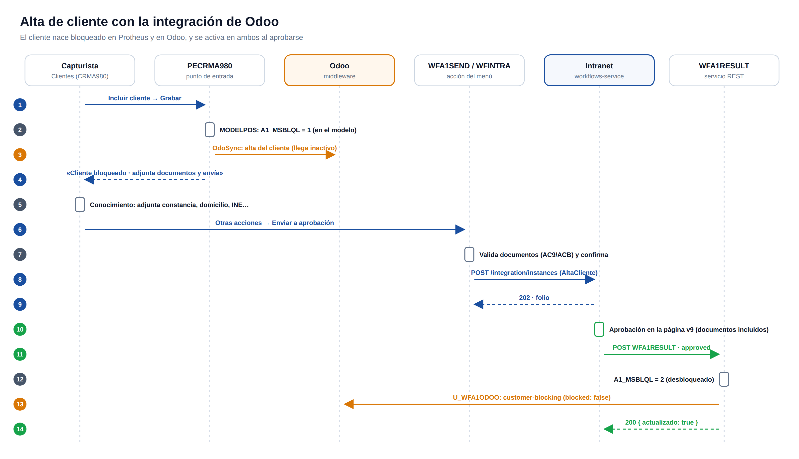

# 03 · Integración con plataformas

## Contrato


En inglés, camelCase, un solo nombre por concepto. `processId`, `tenantId` y `cardData` son fijos para todas las plataformas.

### Envío (plataforma → Intranet)

`POST https://intranet.avalanz.com/api/v1/workflows/integration/instances`
Encabezados: `Content-Type: application/json` · `X-WF-Token: <token de entrada de la conexión>`
Cuerpo en **UTF-8**.

```json
{
  "processId": "CompraDirecta",
  "tenantId": "0101",
  "companyGroup": "02",
  "companyName": "ASESORES GLOBALES INTEGRALES DE MEXICO",
  "resultService": "WFM110RESULT",
  "externalKey": "02|0101|SC1|000014",
  "platform": "totvs",
  "requester": { "id": "000006", "login": "abcovarrubias", "name": "HECTOR ABRAHAM COVARRUBIAS", "email": "..." },
  "cardData": { "numerosolicitud": "000014", "proveedor": "...", "total": 180960, "items": [ { "item": "0001", "...": "..." } ] },
  "files": [ { "name": "cotizacion.pdf", "base64": "...", "contentType": "application/pdf" } ]
}
```

| Campo | Regla |
|---|---|
| `processId` | Debe existir como flujo (o alias) en la conexión del token |
| `tenantId` | Empresa + filial (`0101`); los dos primeros forman, con `companyGroup`, la clave de empresa `02\|01` |
| `resultService` | Servicio REST de la plataforma que recibirá el resultado |
| `externalKey` | Clave única del documento en la plataforma; base de la idempotencia |
| `requester.id` | Id de usuario en la plataforma; la identidad se maneja por este id, no por login |
| `cardData` | Libre por flujo; se regresa intacto. Las listas de objetos (`items`) se muestran como tablas |
| `files` | Opcional; base64; hasta 25 MB por archivo |
| `platform` | Opcional; si viene, debe coincidir con la conexión del token |

Respuestas: `202` (creado) o `200` (ya existía abierto con los mismos datos) con `{ instanceId, folio, status, message }`; `400` (contrato), `401` (token), `404` (flujo desconocido), `409` (flujo o conexión inactivos).

Consultas opcionales para la plataforma: `GET /integration/instances/{instanceId}` y `GET /integration/instances?externalKey=…`. También sirven como prueba de conectividad (ver `U_WFPING`).

### Regreso (Intranet → plataforma)

`POST {url_base de la conexión}/{resultService}/` con la autenticación de la conexión. Cuerpo: todo el sobre original (sin `files`) más:

```json
{
  "instanceId": "uuid", "folio": "WF-AVAL-000014", "approved": true, "rejectReason": "",
  "history": [ { "step": 1, "stepName": "Gerente de compras", "action": "approved",
                 "approver": { "id": "000006", "login": null, "name": "...", "email": "..." },
                 "date": "2026-10-19T12:35:00-06:00", "comment": "" } ],
  "documents": []
}
```

Respuesta esperada (TOTVS): `200 { "actualizado": true, "mensaje": "..." }`. `actualizado: false` o un 4xx se tratan como definitivos; 5xx y tiempo agotado se reintentan.

## Protheus

### Fuentes

| Carpeta | Fuente | Qué hace |
|---|---|---|
| Compartido | `WFINTRA.prw` | `U_WFINTRA` (manda el sobre con `FWRest`, en UTF-8, y lee la respuesta), `U_WFPING` (prueba de conexión), `U_WFREQUESTER` (datos del usuario actual), `U_WFFILES` (documentos del Banco de Conocimiento por consulta a `AC9`/`ACB`), `U_WFJCHAR` |
| SolicitudCompra | `M110STTS.prw` (existente) | Interruptor al inicio: con `MV_XWFON = S` llama a `U_WFM110STTS`; con `N`, sigue con Fluig como antes |
| | `WFM110STTS.prw` | Arma `cardData` desde `aHeader`/`aCols`, adjunta documentos, envía, bloquea la solicitud (`C1_APROV = B`) y guarda folio/id si existen `C1_XWFID`/`C1_XWFFOL` |
| | `WFM110RESULT.prw` | WSRESTFUL: reposiciona `cEmpAnt`/`cFilAnt` con `companyGroup`/`tenantId`, aplica `C1_APROV = L` o `R` y `C1_NOMAPRO`; idempotente si existe `C1_XWFID` |
| AltaCliente | `PECRMA980.PRW` (existente, integración Odoo) | Se le agregó una sección: en un alta con `MV_XWFA1ON = S`, pone `A1_MSBLQL = 1` en el modelo en `MODELPOS` (antes de que la integración de Odoo lea el cliente) y publica `U_WFA1ODOO` para avisar a Odoo los cambios de bloqueo hechos fuera del modelo |
| | `CRM980MDEF.prw` | Agrega "Enviar a aprobación" a Otras acciones del browse de Clientes |
| | `WFA1SEND.prw` | `U_WFA1ENV` (acción del menú: valida documentos y confirma) y `U_WFA1SEND` (arma el sobre con los campos de `SA1` y los documentos de la entidad `SA1`) |
| | `WFA1RESULT.prw` | WSRESTFUL: aprobado → `A1_MSBLQL = 2` y aviso a Odoo; rechazado → sigue bloqueado |

Todos los fuentes se guardan en **Windows-1252 (Latin-1) con CRLF**, como el resto de Protheus; si se guardan en UTF-8, los acentos salen como `ó` en los mensajes.

### Parámetros (SX6, sucursal en blanco)

| Parámetro | Default | Para qué |
|---|---|---|
| `MV_XWFURL` | — | `https://intranet.avalanz.com/api/v1/workflows` |
| `MV_XWFTOKEN` | — | Token de entrada de la conexión TOTVS |
| `MV_XWFTOUT` | 20 | Segundos de espera del envío |
| `MV_XWFON` | N | Solicitud de compra: `S` manda a la Intranet, `N` a Fluig |
| `MV_XWFSC1P` / `MV_XWFSC1S` / `MV_XWFSC1F` | `CompraDirecta` / `WFM110RESULT` / `S` | processId, resultService y si viajan adjuntos |
| `MV_XWFIVA` | 0.16 | Tasa para el total de la solicitud |
| `MV_XWFA1ON` | N | Alta de cliente: `S` bloquea al grabar y habilita el envío |
| `MV_XWFA1MO` | N | Reservado: también al modificar |
| `MV_XWFA1P` / `MV_XWFA1S` / `MV_XWFA1D` | `AltaCliente` / `WFA1RESULT` / `S` | processId, resultService y si los documentos son obligatorios |

Los parámetros son por grupo de empresa (`SX6` de cada grupo); para otro grupo hay que crearlos ahí.

### Campos opcionales recomendados

`C1_XWFID` (C 36) y `C1_XWFFOL` (C 20) en `SC1`: id y folio del trámite. Sin ellos todo funciona, pero sin `C1_XWFID` no hay idempotencia en el regreso de compras.

### Puntos a cuidar



- **Un solo punto de entrada por rutina**: `M110STTS` y `CRMA980` ya existían; por eso se agregaron interruptores y secciones dentro de ellos, nunca un fuente aparte con el mismo nombre.
- **Codificación**: el sobre se manda con `EncodeUTF8`; las respuestas se leen con `DecodeUTF8`. Las respuestas de los servicios REST hacia la Intranet van sin acentos.
- **`FWRest`** solo regresa verdadero con 200; la Intranet contesta 202, así que `WFINTRA` decide por el contenido (`instanceId`) y no por el código.
- **Banco de Conocimiento**: la llave de `AC9_CODENT` no lleva sucursal (cliente: código + tienda); `U_WFFILES` acepta la llave con o sin sucursal y lee los archivos de `MsDocPath()`.
- **Servicio REST**: después de compilar un WSRESTFUL nuevo hay que **reiniciar el servicio REST** (puerto 10107 en desarrollo) para que lo publique; se verifica en `https://avalanz.totvsmx.com:10107/rest/`.
- **Odoo**: el cliente nuevo viaja a Odoo ya inactivo; al aprobar, `WFA1RESULT` lo desbloquea y `U_WFA1ODOO` avisa a Odoo con el mismo endpoint y log (`ZZQ`) de la integración existente.

## Agregar un flujo nuevo

1. **Protheus**: un fuente de envío que arme `cardData` y llame a `U_WFINTRA` (más el enganche en el punto de entrada o una acción de menú), y un WSRESTFUL de regreso que aplique `approved`. Reiniciar el REST.
2. **Intranet**: Flujos → Nuevo flujo con el mismo `processId` y `resultService`; grupos y etapas por empresa; la Hoja con *Detectar campos* en cuanto llegue el primer trámite.
3. Probar con el simulador y luego con un documento real en desarrollo.

Para otra plataforma (Odoo, Detecno…): una conexión nueva en Ajustes y, si su respuesta no es estándar, un conector en `app/plataformas/` (como `totvs.py`).
