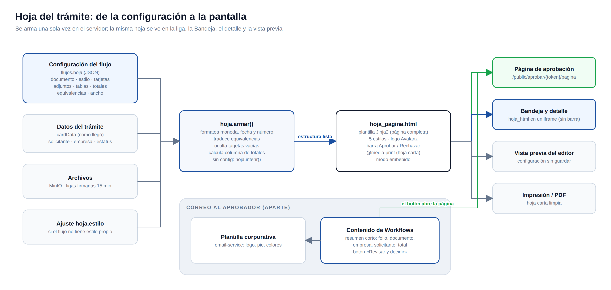

# 04 · Hoja del trámite y plantillas

La **hoja** es cómo se presenta el documento al aprobador. Se configura por flujo (pantalla Flujos → Hoja) y se arma **una sola vez en el servidor**; de ahí salen la página de aprobación, la vista en la Bandeja, el detalle del administrador y la vista previa del editor, así que nunca se desalinean.



## Configuración (`flujos.hoja`, JSON)

```json
{
  "documento": { "etiqueta": "Solicitud de compra", "numero": "numerosolicitud", "area": "Compras" },
  "estilo": "flotante",
  "tarjetas": [
    { "clave": "proveedor", "etiqueta": "Proveedor", "tipo": "texto", "ancho": "ancha" },
    { "clave": "tipoCliente", "etiqueta": "Tipo de cliente", "tipo": "texto", "valores": { "1": "Consumidor final" } }
  ],
  "adjuntos": true,
  "tablas": [{
    "clave": "items", "titulo": "Partidas",
    "columnas": [
      { "clave": "descripcion", "etiqueta": "Producto", "tipo": "texto", "alinear": "izq", "detalle": "producto" },
      { "clave": "valorTotal", "etiqueta": "Importe", "tipo": "moneda", "alinear": "der" }
    ],
    "totales": [
      { "clave": "subtotal", "etiqueta": "Subtotal", "tipo": "moneda" },
      { "clave": "total", "etiqueta": "Total", "tipo": "moneda", "destacado": true }
    ]
  }]
}
```

| Elemento | Reglas |
|---|---|
| `documento.numero` | Clave de `cardData` con el número visible, o `folio` si lo asigna la Intranet |
| `estilo` | `flotante`, `neutro`, `tinta`, `arena`, `clasico`; si no viene, se usa el ajuste `hoja.estilo` |
| Tipos | `texto`, `moneda` ($1,234.00), `numero`, `fecha` (acepta `YYYYMMDD`, `YYYY-MM-DD`, `DD/MM/YYYY`; muestra `18 oct 2026`), `porcentaje` |
| `ancho` | `ancha` ocupa dos columnas (en el teléfono, una) |
| `valores` | Equivalencias: si el valor que llega está en la lista, se muestra el texto; si no, el valor tal cual |
| `detalle` | Otra clave que se muestra en gris junto al valor (por ejemplo el código del producto) |
| Totales | Claves de `cardData` (no de la fila); el destacado va al final |
| Límites | 16 tarjetas, 6 tablas, 14 columnas por tabla, 60 equivalencias por campo |

Validación en `motor/hoja.normalizar` (claves solo con letras, números, punto y guion bajo).

**Sin configuración** (`hoja.inferir`), la hoja se arma sola: los valores simples de `cardData` como tarjetas (con tipo deducido por nombre: `fecha…` → fecha; `importe`, `monto`, `valor`… → moneda), cada lista de objetos como tabla y `subtotal`/`impuesto`/`total` como totales. El editor usa esa misma función en *Detectar campos*.

## Armado (`hoja.armar` → `hoja_db.hoja_de`)

Convierte trámite + configuración en una estructura ya formateada:

```
cabecera  → flujo, etiqueta, número, folio, fecha, empresa, solicitante, área, grupo, filial
estatus   → texto y tono (turno, ok, no, aviso, neutro)
estilo
tarjetas  → [{ etiqueta, valor, ancha }]   (las vacías no se muestran)
adjuntos  → [{ nombre, ext, tamaño, url firmada }]
tablas    → [{ título, columnas, filas, totales, col_total }]
```

## Página de aprobación (`hoja_pagina.py` + `plantillas/hoja_pagina.html`)

Documento HTML completo, autónomo, hecho para Workflows (no depende del frontend de la Intranet):

- `GET /public/aprobar/{token}/pagina` la sirve con la barra **Aprobar / Rechazar** (llama a `POST /public/aprobar/{token}/decidir`; rechazar exige motivo) y el mensaje del estado de la liga.
- La ruta del frontend `/aprobar/[token]` la muestra en un iframe de pantalla completa.
- En la Bandeja y en el detalle del administrador se usa en **modo embebido** (sin barra ni pie): el detalle del trámite trae `hoja_html` y el componente `HojaTramite` lo muestra en un iframe que toma la altura del contenido.
- La vista previa del editor la renderiza con la configuración sin guardar.
- Lleva el logo de Avalanz (`{FRONTEND_URL}/logo_200.png`).

### Estilos

Se activan con `data-tema` en `<html>` (sin atributo = Clásico). Están todos en la misma plantilla:

| Estilo | Idea |
|---|---|
| Flotante (predeterminado) | Bloques blancos con borde y sombra sobre fondo gris |
| Neutro | Blanco y grises, secciones separadas por líneas |
| Tinta | Cabecera azul marino, cuerpo blanco, total en oscuro |
| Arena | Tonos cálidos tipo papel |
| Clásico | El diseño original con encabezados celestes |

Criterios de diseño del proyecto: estilo plano, sin degradados de "Windows XP" y sin bandas laterales de color en avisos o tarjetas.

### Impresión

Bloque `@media print` común a todos los estilos: hoja carta con márgenes de 12 mm, fondo blanco, bordes grises sólidos, línea negra bajo la cabecera, sin botones, sombras ni pie; tarjetas a tres columnas sin cortar texto; la tabla puede partirse entre páginas repitiendo su encabezado, y los totales salen solo al final.

## Correos

Los avisos usan la **plantilla corporativa** del `email-service` (logo, pie, colores) y Workflows manda el contenido: saludo, un **resumen corto** (folio, documento, empresa, solicitante, total destacado y número de adjuntos) y el botón. La hoja completa **no** va dentro del correo: se ve en la página que abre el botón.

El botón (`avisos._boton`) es azul corporativo `#1a4fa0`, centrado, sin tablas (la plantilla corporativa pinta de gris las celdas del contenido) y con versión VML para Outlook de escritorio.

`hoja_correo.py` conserva una versión de la hoja completa para correo (tablas con estilos en línea) por si en algún flujo se necesita mandarla dentro del correo.

## Resumen por flujo (`flujos.resumen`)

Configuración anterior a la hoja, todavía vigente para las **columnas de las tablas de trámites** (Bandeja y Seguimiento): hasta 4 campos de `cardData` y el campo del número de documento. Se edita en Flujos → Datos generales.
